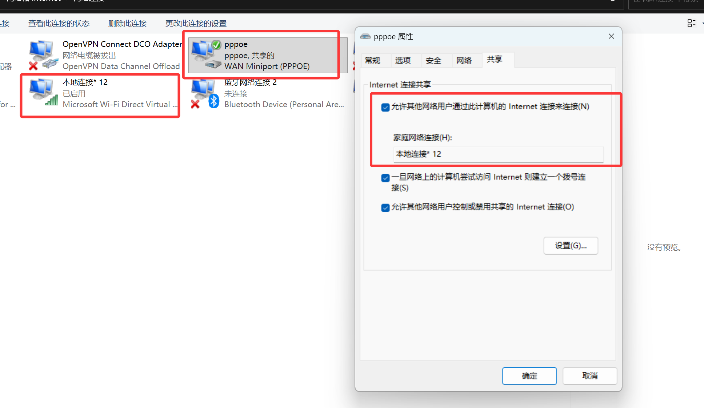
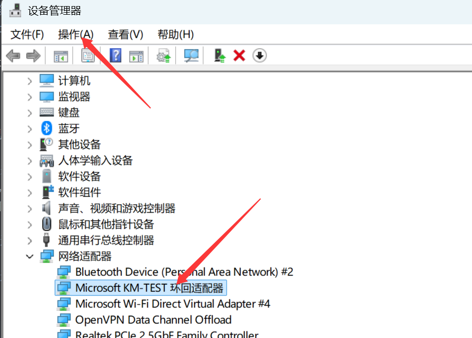

前置需要：
win系统，拨号上网，主机/笔记本有无线网卡， 可以开启WiFi。

拨号上网开启热点

网上教程很多，这里不赘述，只记录关键步骤

步骤：

- 先关闭拨号上网，开启wifi，连接任意wifi后可开启移动热点。
- 连接拨号上网，随后断开wifi网络，注意只断开，wifi仍开启。
- 进入 `控制面板\网络和 Internet\网络和共享中心` 打开网络适配器。
- 右键宽带连接，属性，共享到本地连接*x，注意这个本地连接是开启移动热点后才有的。



之后点开本地连接*12，看到ipv4连接是internet代表已经成功开启。

**但是这样后只是能当无线网用，完成当成路由器还有很大差距，有两个重大问题要解决：**

- 主机使用拨号上网无法使用clash等代理工具开启代理，微软原生沙盒软件也无法上网（如mc todo和微软商店等）
- 由于节能策略或wifi设备策略，这样开启移动热点会自动断开

第一个问题，很简单，需要重命名设备管理器里的【宽带连接】设备为英文名，如上图，我改成了【pppoe】，这个也是网上一搜就有的，改完名重启搞定

第二个问题有点复杂，其根源在于，移动热点需要一个已连接的wifi做载体，通过上述共享的方法属于卡了微软bug（虽然这个本身就是微软的设计缺陷），一段时间没有检测到wifi连接或者节能策略影响就会断连。
所以问题要从根源下手，创建一个回环设备（loopback）让win里那个本地连接*12常驻存在。



> 打开设备管理器
> 操作->添加过时硬件(如果菜单中只有帮助点击一下任一设备或类别就会刷新)
> 安装我手动从列表选择的硬件->显示所有的硬件
> 左侧厂商选择 Microsoft 右侧设备选择 Microsoft KM-TEST 回环适配器
> 重命名虚拟测试设备
> 控制面板->网络和Internet->网络和共享中心->更改适配器设置(左侧)
> 将KM-TEST设备重命名为Loopback(如果右键重命名无效那么选中按F2键入新名称)
> 重启电脑或其他方式传播网路名称。
> 开启热点
> 在cmd执行以下命令，或者直接用PowerShell执行引号中的部分。
>
> powershell -ExecutionPolicy -ByPass "$profile = [Windows.Networking.Connectivity.NetworkInformation,Windows.Networking.Connectivity,ContentType=WindowsRuntime]::GetConnectionProfiles() | where {$_.profilename -eq 'loopback'}; $tether = [Windows.Networking.NetworkOperators.NetworkOperatorTetheringManager,Windows.Networking.NetworkOperators,ContentType=WindowsRuntime]::createFromConnectionProfile($profile); $tether.StartTetheringAsync()"
>
> WLAN也会同时开启。
> 保持热点
> 设备管理器->网络适配器->你的无线网卡(不是MK-TEST而是实际物理网卡) 【右键属性】
> 电源管理->允许计算机关闭此设备以节约电源 【解除勾选】
> 关闭热点
> 直接用任务栏上的操作按钮即可。
> 关闭热点是虚开的WLAN也会关闭。

参考：https://www.cnblogs.com/donghao99/p/18985123

附上开机后可一键启动的bat脚本，注意替换宽带连接设备名和拨号账号密码，注意以下脚本我已把宽带设备重命名为了【pppoe】，虚拟回环设备重命名为了【loopback】

```bat
@echo off
chcp 65001 >nul

echo ========================================
echo       PPPoE 拨号及无线热点启动
echo ========================================

:: 1. PPPoE 拨号
echo.
echo [1/3] 正在连接 PPPoE...

rasdial pppoe 123456 123456

if %errorlevel% neq 0 (
    echo PPPoE 拨号失败！
    pause
    exit /b 1
)

echo PPPoE 拨号成功！

:: 2. 等待网络初始化
echo.
echo [2/3] 等待网络初始化...
timeout /t 5 /nobreak >nul

:: 3. 启动热点
echo.
echo [3/3] 正在启动无线热点...

powershell -ExecutionPolicy -ByPass "$profile = [Windows.Networking.Connectivity.NetworkInformation,Windows.Networking.Connectivity,ContentType=WindowsRuntime]::GetConnectionProfiles() | where {$_.profilename -eq 'loopback'}; $tether = [Windows.Networking.NetworkOperators.NetworkOperatorTetheringManager,Windows.Networking.NetworkOperators,ContentType=WindowsRuntime]::createFromConnectionProfile($profile); $tether.StartTetheringAsync()"

echo.
echo ========================================
echo          全部启动成功！
echo ========================================
pause
```

这样就成功把拨号上网的主机附加了路由器功能，难道我真是天才？
